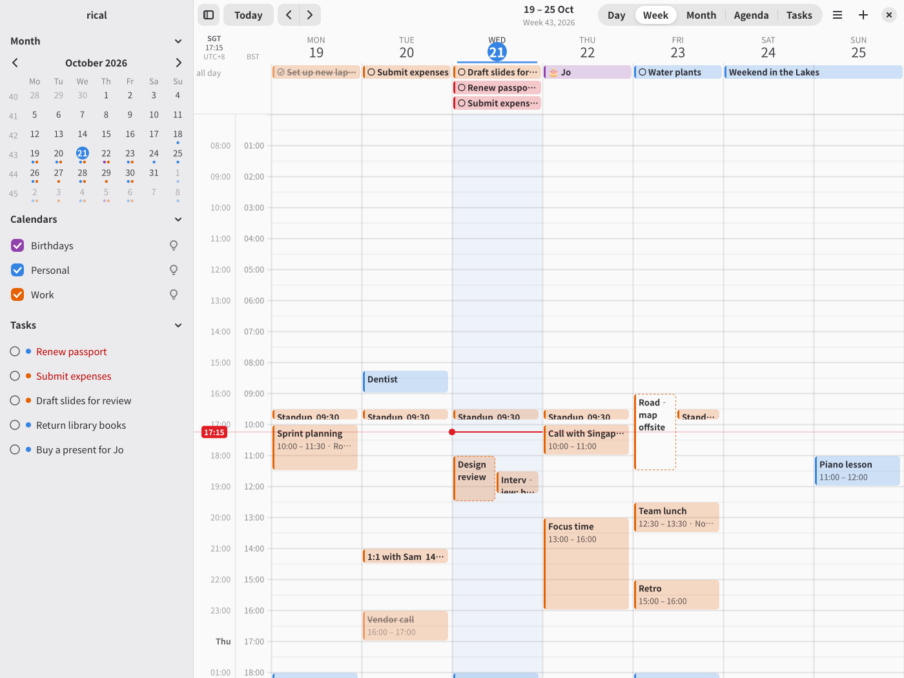
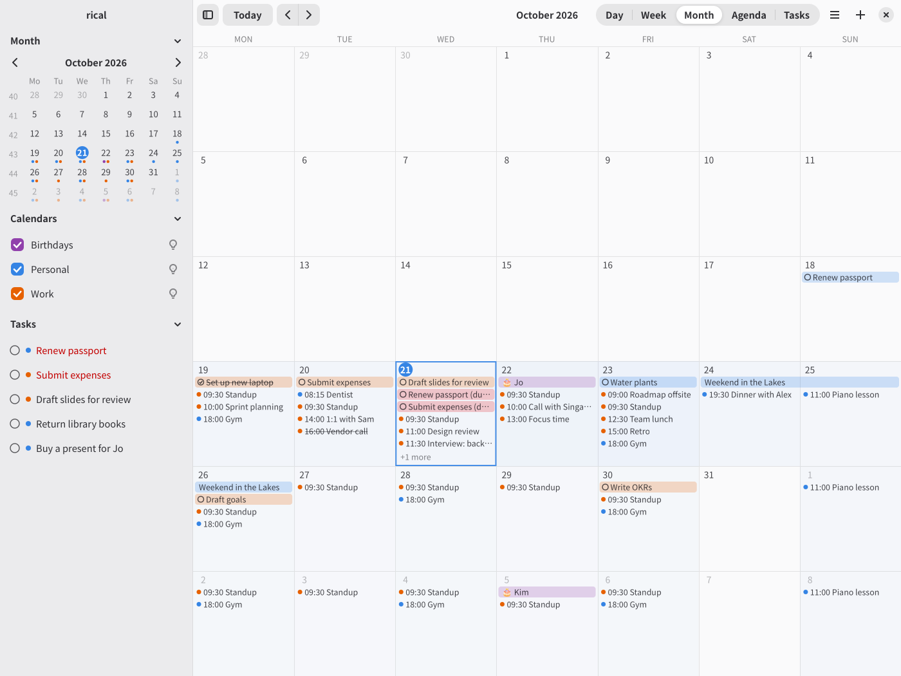
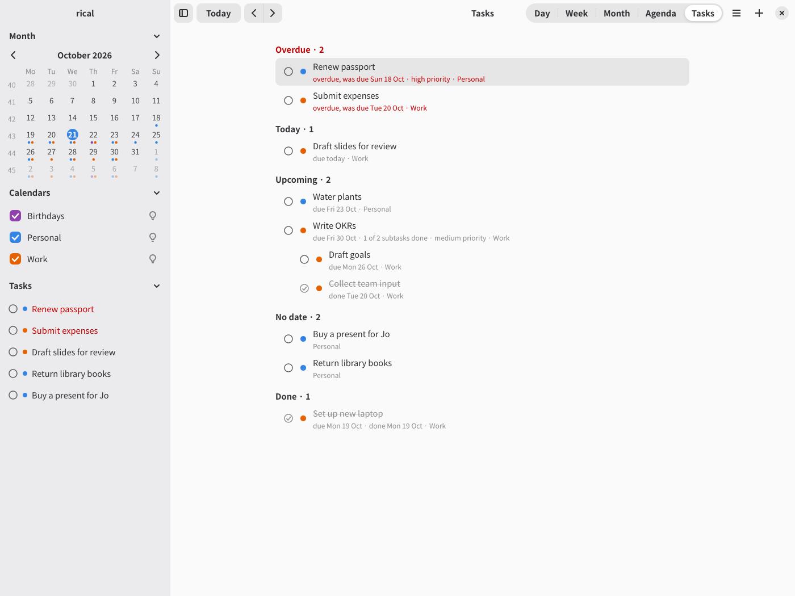

# rical

A keyboard-driven calendar and task list for a [vdir](https://vdirsyncer.pimutils.org/en/stable/vdir.html)
of `.ics` files, such as one kept in sync by vdirsyncer. The files are the
source of truth: rical reads them, writes plain iCalendar back, and picks up
changes made on disk while it runs.

- `rical-gtk`: a GTK4/libadwaita app with day, week, month, agenda and task
  views, recurring events, time zones, subtasks, invitations and reminders.
- `rical`: a CLI for listing, adding, completing and editing items, plus
  `rical remind` for desktop notifications.



| Month | Tasks |
|---|---|
|  |  |

To try it without your own calendars, `scripts/demo-vdir.sh /tmp/demo`
writes the made-up calendars shown here; then run
`RICAL_VDIR=/tmp/demo rical-gtk`.

## Install

```sh
nix run github:jeffa5/rical           # or: nix profile install github:jeffa5/rical
cargo install --path crates/rical-gtk  # needs GTK 4 and libadwaita
```

The flake also has a Home Manager module (`programs.rical`).

## Configure

`~/.config/rical/config`, as `name = value` lines:

```ini
vdir = ~/calendars
week = workweek
remind = 10m
zones = UK=Europe/London
```

Each setting can also come from the environment (`RICAL_VDIR=...`).
`rical-gtk --help` lists them all.

## Use

Every action is a `:command` with completion, and keys are bound to
commands (aerc style). Press `?` for help, `:` for the command line, `c` for a
new event, `e` to edit, `D` to mark a task done. `I` lists invitations
waiting for your reply; `y`, `Y` and `N` accept, answer maybe, or decline
(your server, e.g. Nextcloud, tells the organiser). Change the bindings in
`~/.config/rical/binds.conf`.

Add things in plain language; the command line shows what it understood
before you press Enter, and `rical new` reads the same:

```text
:new Lunch with Sam at Bistro 21 tomorrow 1pm for 90m
:new Meet Priya 3 jun 10am London time @ King's Cross
:new Standup every weekday 9:30 for 15m #work
:new Offsite 3-5 dec
:task Submit expenses by fri 5pm !
```

## License

MIT
