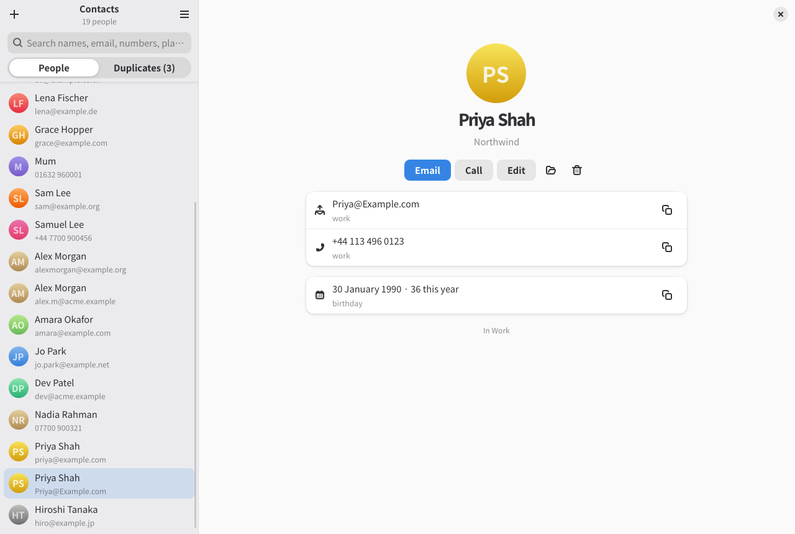
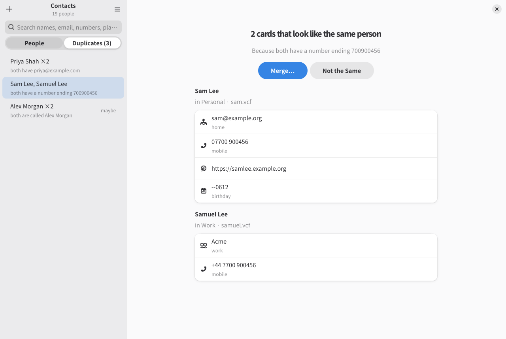

# Contacts

`rical-contacts` (“Contacts (rical)” in your launcher) is the calendar's
companion for address books: folders of vCard (`.vcf`) files, the layout
vdirsyncer keeps in sync with a CardDAV server. It looks and works like the
calendar: every action is a `:command`, keys are bound to commands, and the
files on disk are the source of truth.

What it is for:

- **Finding people fast.** Search covers every field, including names,
  nicknames, email addresses, phone digits, organisations, addresses,
  groups and notes. It stays instant with tens of thousands of contacts.
- **Opening contacts from other apps.** Opening a `.vcf` matches it to your
  address books by UID first, so you see the card you already have instead
  of a copy.
- **Editing** without losing anything. Only the fields you change are
  rewritten, and each card keeps its vCard version and everything this app
  doesn't show.
- **Tidying up.** It finds cards that look like one person and merges them
  into one, so your contacts don't sprawl.



## Getting started

Point it at the folder holding your address books (each a folder of `.vcf`
files). Without a setting it uses `~/contacts` if that folder exists.

```sh
RICAL_CONTACTS_CONTACTS=~/contacts rical-contacts
```

Or put `contacts = ~/contacts` in `~/.config/rical/contacts/config`.

To try it without your own contacts, run
`scripts/demo-contacts.sh /tmp/c`, which writes made-up address books with
a few duplicates. Then run `RICAL_CONTACTS_CONTACTS=/tmp/c rical-contacts`.

## Settings

Settings work as the calendar's do (see [Configuration](configuration.md)),
with the app's own files and environment prefix:

- They live in `~/.config/rical/contacts/config`, then `local.conf` beside
  it.
- The environment wins over both: `RICAL_CONTACTS_<NAME>`, upper-cased with
  dashes as underscores.
- Preferences (`Ctrl+,`) edits them in place.

| Setting | What it does |
|---|---|
| `contacts` | The folder of address books. Default `~/contacts` if it exists. |
| `book` | The address book new contacts go in, by folder or display name. Default: the one with the most contacts. |
| `sort` | How the list is sorted: `name` (as shown, so “Sam Lee” under S; the default) or `family` (by family name, then given). |
| `binds` | Key bindings file. Default `~/.config/rical/contacts/binds.conf` if it exists. |
| `renderer` | How GTK draws: `cairo` (the default, least memory), `gl`, `vulkan` or `auto`. |
| `history`, `history-days` | Where the history is kept, and for how many days (30). See [History and undo](history.md). |

The log is `~/.local/state/rical/contacts/rical.log`. About (`:about`)
shows the log's location and the details for a bug report.

## Finding people

The list shows everyone, sorted by name as shown (or by family name: the
`sort` setting). Each row shows an email
address or number to tell people apart.

- `/` (or `Ctrl+F`) moves to the search box. Type any part of any field:
  `leeds`, `acme`, `7700 9`, `jo@`. Words narrow the search, so `sam leeds`
  finds Sams in Leeds.
- Numbers match however either is written. Spaces, dashes, dots and
  brackets don't matter, and digits typed with spaces are one run:
  `7700 900` is `7700900`. A national number with its trunk 0
  (`07700 900123`) finds one saved with a country code
  (`+44 7700 900123`), and the other way round (`+44` or `0044`). Any part
  of a number will do.
- `Down` goes from the search to the list, and Enter opens the first
  result.
- `j`/`k` (or the arrows) move through the list, and `g`/`G` jump to the
  first and last.
- Escape steps back: from the person to the list on a narrow window, then
  out of the search.

The right-hand pane shows the selected person. Every way to reach them is a
link: an email address writes to them, a number calls, and an address opens
a map. Each has a copy button. **Saved in**, below the card, lists the file
they are in, from the contacts folder (`contacts/work/sam.vcf`), with its
address book. It also lists any copy of the same card (by UID) in another
book. Clicking a file opens its folder, and the copy button copies its full
path.

Anything that writes says where first:

- The editor shows the file an edit changes. For someone new, it shows the
  folder of the address book chosen.
- Quick add's preview line names the folder too.
- When a contact opened from elsewhere is added, the prompt names the folder.
- The merge dialog lists the file the merged card is saved to, and the files
  deleted afterwards.

From the keyboard:

- `M` writes to their preferred email address.
- `P` calls their preferred number.
- `A` opens their address on a map.
- `y` and `Y` copy their email address and number.
- `:copy name`, `:copy address` and `:copy card` copy the rest (`card` is
  the whole vCard).
- `O` opens their file in another app; it always asks which.

## Adding and editing

- `c` (or the + button) opens the editor for someone new.
- `C` starts a quick add on the command line: `:new Jo Park
  jo@example.com +44 113 496 0000`. Words with an `@` become email
  addresses, runs of digits a number, and the rest the name. As you type,
  the line below the command shows what will be made and where. Add `--book
  NAME` to choose the address book.
- `e` edits the selected person, and `x` deletes them.

In the editor:

- Tab moves between fields; Ctrl+Enter or Ctrl+S saves, and Escape
  cancels.
- Email addresses, numbers, addresses and websites can each be added,
  labelled (home, work, mobile…) and removed.
- The full name follows the given and family names until you change it
  yourself.
- Dates can be typed as `1990-01-31`, `31/1/1990` or `31 Jan 1990`. With no
  year, as in `31 Jan`, a birthday is saved without one.

New contacts are vCard 4.0. An edited card keeps its version (3.0 from
Apple and Google, say). Only the lines you changed are rewritten, so
photos, custom fields and Apple's labels are kept.

Every change can be undone with `u` (or Ctrl+Z) and redone with `U` (or
Ctrl+Shift+Z), even after a restart. A merge undoes as one step. `Ctrl+H`
(`:history`) lists every change to undo any of them, even several back.
Deleting someone asks first. See [History and undo](history.md).

## Opening contacts from other apps

Opening a `.vcf` file hands it to Contacts. If Contacts is already running,
the file goes to the open window. It works from a file manager, a mail
attachment, or the calendar's guests. Each card in the file is matched to
your address books:

| The card is… | What happens |
|---|---|
| one you have (same UID), saying the same | It is shown. |
| one you have, changed since | You're asked whether to update yours. If the opened card is newer (by its `REV`), updating is the default. |
| someone you probably have: no UID in common, but an email address or number | You're asked to merge it into theirs, add it as someone new, or skip it. |
| someone new | You're asked which address book to add them to. |

When a file holds several cards, you're asked about each in turn, and the
new ones are added together at the end. A card opened from inside your
address books is simply shown.

To make Contacts open `.vcf` files by default, set
`programs.rical.openContactFiles = true` in Home Manager. Or run
`xdg-mime default net.jeffas.Rical.Contacts.desktop text/vcard`.

## Tidying up duplicates

`2` (or the Duplicates switch) lists the cards that look like one person,
with the count on the switch. Under **Likely the same** are cards that have:

- the same email address (ignoring case),
- the same number (by its last nine digits, so `07700 900456` and
  `+44 7700 900456` match), or
- the same UID within one address book.

Below them, under **Same name only**, are cards that share nothing but a
name: two Alex Morgans may be two people. The same card in two address
books (two synced accounts) is a copy, not a duplicate, and isn't listed.



Selecting a group shows its cards side by side.

- `m` (or Enter) merges them. Contacts keeps the card that says the most and
  takes in everything the others add: email addresses, numbers, addresses,
  websites, nicknames, groups and notes, each once. Where the cards
  disagree on one value (two names, two birthdays), you choose which to
  keep, and the merged card updates as you do.
- After merging, Contacts asks whether to delete the other cards. Deleting
  is the default; choose Keep Them to leave them. Undo brings everything
  back as it was.
- `i` says the cards are different people. The group isn't suggested again;
  the answer is remembered in `~/.local/state/rical/contacts/state`.

## Keys

| Key | Command | |
|---|---|---|
| `:` | | the command line |
| `?` | `help` | key bindings |
| `/`, `Ctrl+F` | `search` | search |
| `1`, `2` | `view people`, `view duplicates` | views |
| `j`, `k`, `g`, `G` | `select next/prev/first/last` | moving |
| Escape | `back` | back out |
| `c`, `Ctrl+N` | `new` | new contact (the editor) |
| `C` | `new ` | quick add |
| `e`, `Ctrl+E` | `edit` | edit |
| `x`, Delete | `delete` | delete |
| `M`, `P`, `A` | `mail`, `call`, `map` | reach them |
| `y`, `Y` | `copy email`, `copy phone` | copy |
| `O` | `open-file` | open in another app |
| `m`, Enter | `merge` | merge duplicates |
| `i` | `not-duplicates` | not the same person |
| `u`, `U` | `undo`, `redo` | |
| `Ctrl+H` | `history` | undo anything, even after a restart |
| `Ctrl+R`, F5 | `reload` | read the files again |
| `Ctrl+,` | `settings` | Preferences |
| `Ctrl+Q` | `quit` | |

Bindings are changed as the calendar's are (see [Keys](keys.md)), in
`~/.config/rical/contacts/binds.conf`, with the sections `[global]`,
`[people]` and `[duplicates]`.

## Files

Contacts reads every folder of `.vcf` files under `contacts`, at any depth,
skipping hidden ones. A folder's `displayname` file names it. It writes:

- new cards as `<UID>.vcf`, one card per file;
- edits in place, refusing if the file changed on disk since it was read
  (reload and try again);
- deletions by removing the file.

A file holding several cards can be read and searched. Edit or delete it in
another app.

Changes made on disk while it runs (by vdirsyncer, say) show up within a
moment: only the changed files are read again.
